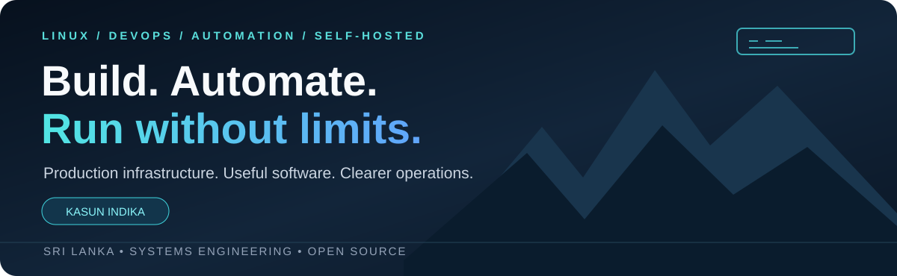

### Kasun Indika

**Infrastructure Engineer &nbsp;·&nbsp; Automation Builder &nbsp;·&nbsp; Open-Source Developer**

Based in Sri Lanka &nbsp; | &nbsp; 17+ years working with real-world IT systems

  

---

### ✦ The work behind the code

I turn operational challenges into dependable tools and infrastructure. That means building useful software, keeping servers healthy, automating repetitive tasks, and making complex systems easier to manage.

My background spans **Linux administration, Docker, cloud and self-hosted infrastructure, observability, storage, networking, and application development**. I value software that makes a practical difference—not just polished demos.

### ◈ Selected products & projects

*An intentionally small selection of substantial work, not a feed of recent repositories.*

<table>
<tr>
<td width="50%" valign="top">

#### 📡 [StackPulse](https://github.com/kasundigital/StackPulse-Prod)

**Infrastructure monitoring, without the noise.**

A self-hosted command center for server health, service checks, Docker visibility, alerts, incidents and status pages.

MONITORING · DOCKER · INCIDENTS

[Website ↗](https://getstackpulse.com)

</td>
<td width="50%" valign="top">

#### ✉️ [MailPilot](https://github.com/kasundigital/MailPilot)

**Email operations under your control.**

A Docker-first email campaign platform with SMTP management, audience segmentation, campaign building and delivery insights.

NODE.JS · AUTOMATION · EMAIL

</td>
</tr>
<tr>
<td width="50%" valign="top">

#### 🧪 [QADeck](https://github.com/kasundigital/QADeck)

**Find issues before users do.**

A self-hosted browser QA workspace for real Chromium testing, visual evidence, accessibility checks and issue tracking.

PLAYWRIGHT · QA · DEV TOOLS

</td>
<td width="50%" valign="top">

#### 🎬 [ArrView](https://github.com/kasundigital/ArrView)

**See what your media library is missing.**

A compact Radarr and Sonarr companion for missing media, audio languages and download troubleshooting.

SELF-HOSTED · MEDIA · DIAGNOSTICS

</td>
</tr>
<tr>
<td width="50%" valign="top">

#### 💾 [VOD Storage Monitor](https://github.com/kasundigital/VOD-Storage-Monitor)

**Make large storage understandable.**

A read-only view of mergerfs capacity, mdadm RAID, SMART health and SnapRAID maintenance information.

STORAGE · LINUX · OBSERVABILITY

</td>
<td width="50%" valign="top">

#### 🛡️ [ArrGuard](https://github.com/kasundigital/arrguard)

**Recover from bad downloads automatically.**

An early-stage utility to detect unusable Sonarr/Radarr downloads, reject problematic releases and request replacements.

PYTHON · AUTOMATION · SERVARR

</td>
</tr>
</table>

<a href="https://github.com/kasundigital?tab=repositories"><b>Explore all repositories →</b></a>

### ◈ Portfolio & professional work

**From infrastructure to intelligent automation.**

I build and maintain Linux environments, design resilient Docker deployments, develop internal systems, and automate day-to-day operations. Some of my most demanding infrastructure work is private client work, so it doesn't appear in public repositories.

**[Visit my portfolio & professional website →](https://www.kasunindika.com)**

### ◈ My engineering toolbox

| Specialty | Practical tools |
| --- | --- |
| **Systems & virtualization** | Linux · Ubuntu · Debian · Windows Server · Proxmox · VMware |
| **Containers & automation** | Docker · Compose · Ansible · Bash · Python · n8n |
| **Development** | JavaScript · Node.js · PHP · APIs · SQL |
| **Monitoring & reliability** | Prometheus · Grafana · Loki · Netdata · Uptime Kuma |
| **Networks & delivery** | Nginx · Caddy · Cloudflare · DNS · TLS · GitHub Actions |
| **Storage & data** | RAID · mergerfs · SnapRAID · MariaDB · PostgreSQL |

### ◈ GitHub activity

Generated by the existing repository workflow. Public GitHub activity represents only part of my work.

---

### Have an infrastructure challenge or a product idea?

I’m interested in useful software, dependable systems and thoughtful technical collaboration.

[**Portfolio**](https://www.kasunindika.com) &nbsp;·&nbsp; [**LinkedIn**](https://www.linkedin.com/in/kasundigital/) &nbsp;·&nbsp; [**GitHub**](https://github.com/kasundigital)

Designed &amp; Developed by <a href="https://www.kasunindika.com">Kasun Indika</a>

