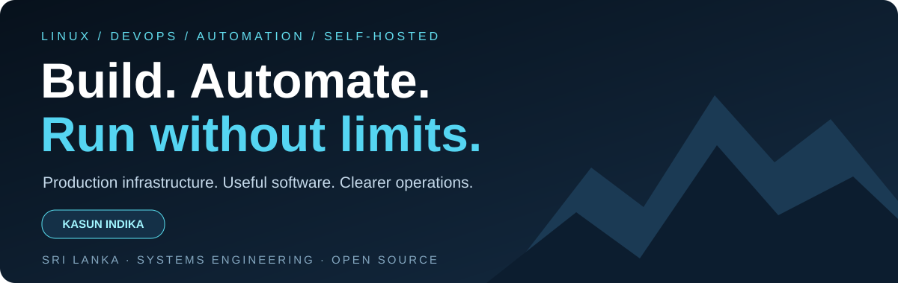
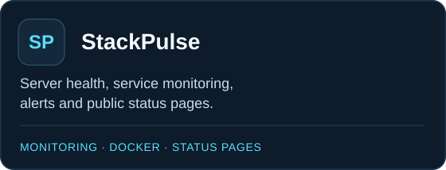
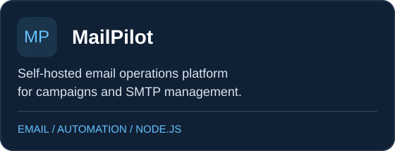
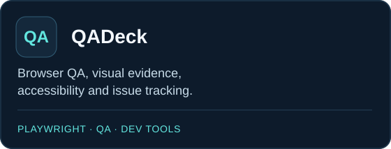
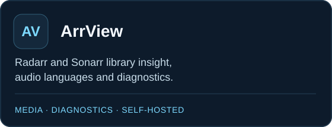
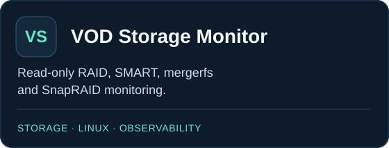
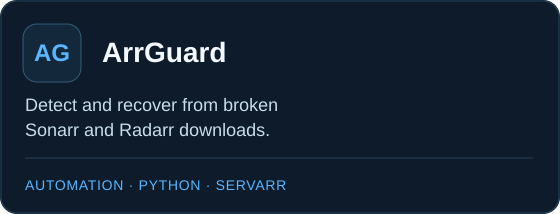
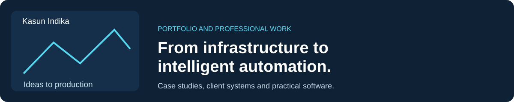

  

  <h3>Kasun Indika</h3>
  
<strong>Infrastructure Engineer</strong> · <strong>Automation Builder</strong> · <strong>Open-Source Developer</strong>

  
Based in Sri Lanka · 17+ years working with real-world IT systems

  

    
    
    
  

---

## ✦ The work behind the code

I turn operational challenges into dependable tools and infrastructure. That means building useful software, keeping servers healthy, automating repetitive tasks, and making complex systems easier to manage.

My background spans **Linux administration, Docker, cloud and self-hosted infrastructure, observability, storage, networking, and application development**. I value software that makes a practical difference—not just polished demos.

## ◈ Selected products & projects

<i>An intentionally small selection of substantial work, not a feed of recent repositories.</i>

<table>
  <tr>
    <td width="50%"></td>
    <td width="50%"></td>
  </tr>
  <tr>
    <td width="50%"></td>
    <td width="50%"></td>
  </tr>
  <tr>
    <td width="50%"></td>
    <td width="50%"></td>
  </tr>
</table>

<a href="https://github.com/kasundigital?tab=repositories"><b>Explore all repositories →</b></a>

## ◈ Portfolio & professional work

## ◈ Engineering toolbox

| Specialty | Practical tools |
| --- | --- |
| **Systems & virtualization** | Linux · Ubuntu · Debian · Windows Server · Proxmox · VMware |
| **Containers & automation** | Docker · Compose · Ansible · Bash · Python · n8n |
| **Development** | JavaScript · Node.js · PHP · APIs · SQL |
| **Monitoring & reliability** | Prometheus · Grafana · Loki · Netdata · Uptime Kuma |
| **Networks & delivery** | Nginx · Caddy · Cloudflare · DNS · TLS · GitHub Actions |
| **Storage & data** | RAID · mergerfs · SnapRAID · MariaDB · PostgreSQL |

## ◈ GitHub activity

  
   
  
   
  Generated by the existing repository workflow. Public GitHub activity represents only part of my work.

---

  <h3>Have an infrastructure challenge or a product idea?</h3>
  
I’m interested in useful software, dependable systems and thoughtful technical collaboration.

  
<a href="https://www.kasunindika.com"><b>Portfolio</b></a> · <a href="https://www.linkedin.com/in/kasundigital/"><b>LinkedIn</b></a> · <a href="https://github.com/kasundigital"><b>GitHub</b></a>

  Designed &amp; Developed by <a href="https://www.kasunindika.com">Kasun Indika</a>

