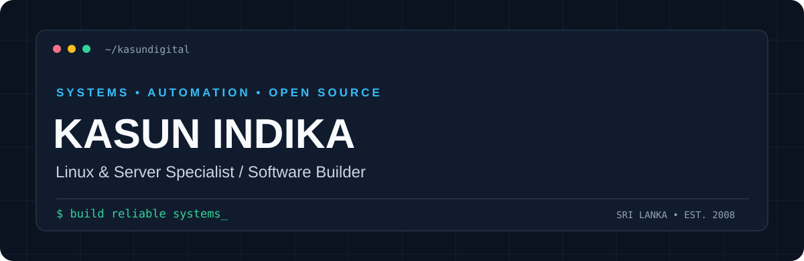

 

**Freelance IT Consultant** &nbsp;•&nbsp; **Linux & Server Administrator** &nbsp;•&nbsp; **Open-Source Builder**

17+ years turning complex infrastructure into dependable, maintainable systems.

  

---

### 01 / THE SHORT VERSION

I’m **Kasun**, a Sri Lanka–based infrastructure specialist and builder. I’ve worked across Linux and Windows environments, virtualization, large-scale storage, Docker, cloud services and production troubleshooting. I also create the tools I wish existed: small automations, observability dashboards, self-hosted utilities and open-source integrations.

**My focus:** reliable operations, useful diagnostics, and software that solves real problems.

<b>More about my background</b>

 

My work spans practical infrastructure administration and full-stack delivery, including Linux server maintenance, reverse proxies, backup workflows, media automation, API integration, monitoring, deployment and technical consulting. Much of my client work is private, so my public repositories focus on reusable tools and community solutions.

### 02 / SELECTED WORK

<table>
<tr>
<td width="50%" valign="top">

**[🚑 ArrMedic](https://github.com/kasundigital/arrmedic)**

A diagnostics toolkit for Sonarr, Radarr and related self-hosted media workflows. Built to make failed imports, paths, queues and permissions easier to understand.

<b>DOCKER · DIAGNOSTICS · SELF-HOSTED</b>

</td>
<td width="50%" valign="top">

**[☀️ HA SolisCloud](https://github.com/kasundigital/ha-soliscloud)**

A Home Assistant integration for SolisCloud, with a focus on useful solar monitoring and compatibility.

<b>PYTHON · HOME ASSISTANT · ENERGY</b>

</td>
</tr>
<tr>
<td width="50%" valign="top">

**[🧪 QADeck](https://github.com/kasundigital/QADeck)**

A self-hosted, Docker-first QA automation platform for browser testing and actionable reports.

<b>PLAYWRIGHT · TESTING · CI/CD</b>

</td>
<td width="50%" valign="top">

**[🔎 arr-lang-scanner](https://github.com/kasundigital/arr-lang-scanner)**

Inspect audio languages across Sonarr and Radarr libraries, with practical multi-server workflows.

<b>PYTHON · FASTAPI · DOCKER</b>

</td>
</tr>
</table>

<b>Explore more utilities</b>

 

- **[Jellyfin Exporter](https://github.com/kasundigital/jellyfin-exporter)** — monitoring data for Jellyfin environments
- **[Python App Deployer](https://github.com/kasundigital/python-app-deployer)** — deploy Python services with less repetitive setup
- **[Trakt to Letterboxd](https://github.com/kasundigital/trakt-to-letterboxd)** — practical media workflow automation

### 03 / TOOLKIT

| Area | Technologies |
| :--- | :--- |
| **Infrastructure** | Ubuntu · Debian · Windows Server · Proxmox · VMware ESXi |
| **Containers & delivery** | Docker · Compose · GitHub Actions · Ansible · systemd |
| **Code & automation** | Python · Bash · JavaScript · Node.js · PHP · n8n |
| **Observability** | Grafana · Prometheus · Loki · Netdata · Uptime Kuma |
| **Networks & security** | Nginx · Caddy · Cloudflare · DNS · TLS · VPN |
| **Data** | PostgreSQL · MariaDB · MySQL · SQL Server |

### 04 / GITHUB ACTIVITY

Stats are generated by the existing repository automation; they reflect public coding activity, not the full scope of infrastructure work.

### 05 / WORK TOGETHER

I help with **Linux and Docker infrastructure, server administration, troubleshooting, monitoring, automation and self-hosted software**. I’m also open to collaboration on useful open-source tools.

**[Explore my work →](https://www.kasunindika.com)** · **[Connect on LinkedIn →](https://www.linkedin.com/in/kasundigital/)** · **[Browse GitHub →](https://github.com/kasundigital?tab=repositories)**

---

BUILD RELIABLE SYSTEMS · AUTOMATE REPETITIVE WORK · SHARE WHAT HELPS

 

Designed & Developed by <a href="https://www.kasunindika.com">Kasun Indika</a>

